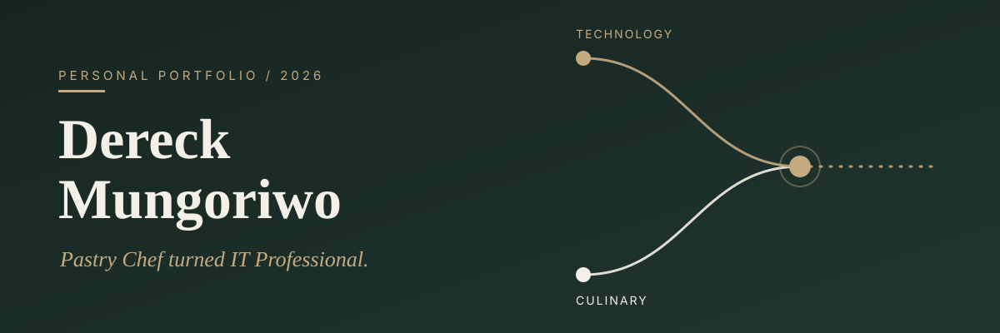
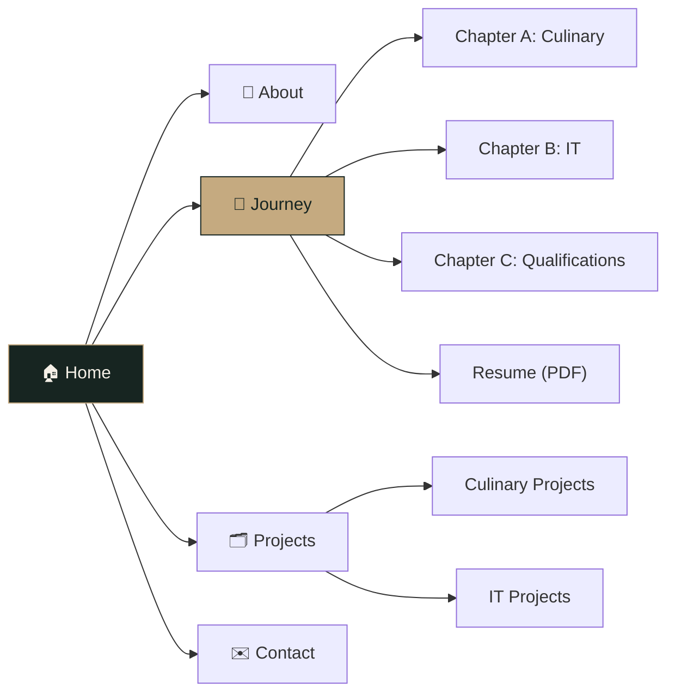

<div align="center">



<br>

# A Journey of Creativity, Technology & Growth

My personal portfolio: two professional paths, one continuous story.

<br>

[](https://dereckmungoriwo.com)
[](https://www.linkedin.com/in/dereckmungoriwo)
[](mailto:dereck@dereckmungoriwo.com)


</div>

---

## ✨ About this project

This website documents my career across **two industries**: six years in professional kitchens, specialising in pastry, and a growing career in **Information Technology** with a focus on networking and cloud computing.

It is built as a hand-coded, framework-free site where every page has its own HTML and CSS for easy debugging, with shared styles and scripts kept in one place.

> **Culinary** gave me precision, discipline and creativity.
> **Technology** gave me a new way to build and solve problems.

---

## 🗺️ Pages

| Page | Purpose |
|---|---|
| **Home** | First impression: introduction, career highlights, featured projects and CV download |
| **About** | The person behind the experience: story, values, interests and vision |
| **Journey** | The full career history: culinary path, IT path, qualifications and resume |
| **Projects** | Two separate collections: image-led culinary dishes and detailed IT projects |
| **Contact** | Direct contact, social profiles and a message form |

### Site map



### The career story it tells

```mermaid
flowchart LR
    D["Diploma in Professional Cookery"] --> T["Chef Trainee"]
    T --> CC["Commis Chef"]
    CC --> DC["Demi Chef de Partie"]
    DC --> CP["Chef de Partie, Pastry"]
    CP --> B["Bachelor's in IT"]
    B --> F["Freelance IT work"]
    F --> N(["Next chapter"])
    style D fill:#172521,color:#F5F0E7
    style T fill:#172521,color:#F5F0E7
    style CC fill:#172521,color:#F5F0E7
    style DC fill:#172521,color:#F5F0E7
    style CP fill:#172521,color:#F5F0E7
    style B fill:#C5AA80,color:#172521
    style F fill:#C5AA80,color:#172521
    style N fill:#F5F0E7,color:#172521,stroke:#C5AA80,stroke-width:2px
```



---

## 🎨 Design

An editorial personal website blended with a modern professional portfolio: warm neutrals, deep green and subtle gold.

| Colour | Hex | |
|---|---|---|
| Forest green | `#172521` |  |
| Warm ivory | `#F5F0E7` |  |
| Muted gold | `#C5AA80` |  |
| Stone grey | `#777D78` |  |
| Charcoal | `#282B2A` |  |

**Typography:** [Playfair Display](https://fonts.google.com/specimen/Playfair+Display) for headings, [Inter](https://fonts.google.com/specimen/Inter) for body text and navigation.

<!--
  ADD SCREENSHOTS HERE
  1. Save images in docs/screenshots/  (e.g. home.png, projects.png)
  2. Uncomment and edit the lines below

  <p align="center">
    
    
  </p>
-->

---

## 🧩 Features

- 📱 **Mobile-first and responsive** from phones to wide desktops
- 🧱 **One HTML + one CSS file per page**, plus a shared `global.css` for tokens, header, footer and buttons
- 🔽 **Interactive dropdowns** for culinary dishes and detailed IT project write-ups
- 🍽️ **Filterable dish gallery** (All / Main courses / Pastry)
- 🕒 **Visual career timeline** with the two paths colour-coded
- 📄 **Downloadable CV** from the Home and Journey pages
- ✉️ **Contact form** with validation, a spam trap and a Formspree option
- ♿ **Accessible by design:** semantic HTML, focus states, ARIA on interactive controls, reduced-motion support
- 🔖 **Save buttons** on images, remembered in the browser

---

## 🛠️ Tech stack

| Layer | Tools |
|---|---|
| Markup | HTML5 |
| Styling | CSS3 (custom properties, Grid, Flexbox) |
| Behaviour | Vanilla JavaScript |
| Icons | [Font Awesome](https://fontawesome.com/) (Contact page) |
| Fonts | Google Fonts |
| Form handling | [Formspree](https://formspree.io/) (optional) |

---

## 📁 Project structure

```text
.
├── index.html            Home
├── about.html            About
├── journey.html          Career journey
├── projects.html         Projects
├── contact.html          Contact
│
├── css/
│   ├── global.css        Shared: tokens, header, footer, buttons
│   ├── home.css
│   ├── about.css
│   ├── journey.css
│   ├── projects.css
│   └── contact.css
│
├── js/
│   ├── main.js           Shared: menu, active link, save buttons
│   ├── projects.js       Dropdowns and dish filter
│   └── contact.js        Form validation and sending
│
├── images/               Photos (see the list below)
├── files/
│   └── resume.pdf        CV for download
└── assets/
    └── banner.svg        README banner
```

<details>
<summary><b>🖼️ Images the site expects</b></summary>

| Page | Files |
|---|---|
| Home | `profile.jpg` (4:3), `culinary.jpg`, `technology.jpg` |
| About | `about-portrait.jpg` (4:5) |
| Journey | `diploma-certificate.jpg` (A4 portrait), `degree-certificate.jpg` (US Letter landscape) |
| Projects: culinary | `pastry-1.jpg` to `pastry-3.jpg`, `main-1.jpg` to `main-3.jpg` (4:5) |
| Projects: IT | `it-project-1.jpg` to `it-project-4.jpg` (16:10) |

</details>

---
## 📬 Get in touch

| | |
|---|---|
| 📧 Email | [dereck@dereckmungoriwo.com](mailto:dereck@dereckmungoriwo.com) |
| 💼 LinkedIn | [dereckmungoriwo](https://www.linkedin.com/in/dereckmungoriwo) |
| 🐙 GitHub | [dereckmungoriwo](https://github.com/dereckmungoriwo) |
| 🌐 Website | [dereckmungoriwo.com](https://dereckmungoriwo.com) |

---

## 📄 License

© 2026 Dereck Mungoriwo. All rights reserved.
Text, photographs and certificates on this site are personal and may not be reused. You are welcome to learn from the code structure, but please build your own content.

<div align="center">

*Every chapter has shaped who I am.*

</div>
